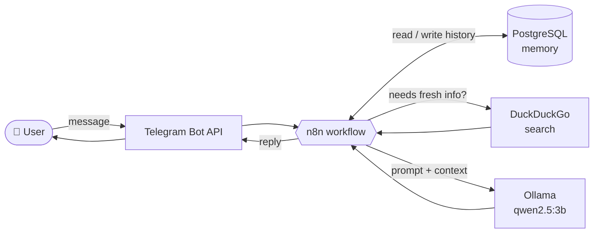

<div align="center">

# ⚡ n8n Workflows

**Import-and-run automations: AI assistants, content tools, lead ops, meeting notes.**

[](https://n8n.io)
[-000000?logo=ollama&logoColor=white)](https://ollama.com)
[](https://www.postgresql.org)
[](LICENSE)
[](CONTRIBUTING.md)


[Quick Start](#-quick-start) · [Workflows](#-workflows) · [Architecture](#-architecture) · [Structure](#-project-structure) · [Contributing](#-contributing)

<!-- TODO: replace with a real screenshot or GIF of the Telegram bot in action -->
<!--  -->

</div>

---

## 🚀 Quick Start

```text
1. Download a .json file from /<workflow>/workflows/
2. n8n → Workflows → Import from File
3. Attach credentials (Telegram, Postgres, Ollama, ...)
4. Activate
```

<details>
<summary><b>🐳 Need a local stack? (n8n + Ollama + Postgres)</b></summary>

```bash
# Ollama model used by the Personal Assistant
ollama pull qwen2.5:3b

# Postgres schema for conversation memory
psql -U <user> -d <db> -f personal-assistant/schema/memory-schema.sql

# n8n
npx n8n
```

</details>

---

## 🧭 Workflows

> Pick a category. Click a row's folder for setup details.

<details open>
<summary><b>🤖 AI Assistants</b></summary>

| Workflow | What it does | Stack |
|---|---|---|
| [**Personal Assistant**](personal-assistant/) | Telegram bot with persistent memory and live web search | Telegram · Ollama · Postgres · DuckDuckGo |

</details>

<details>
<summary><b>✍️ Content & Marketing</b></summary>

| Workflow | What it does |
|---|---|
| [**Content Repurposer**](content-repurposer/) | Turn one piece of content into multiple platform-specific formats with AI |
| [**LinkedIn Automation**](linkedin/) | Generate and schedule LinkedIn posts with AI |

</details>

<details>
<summary><b>📈 Business Operations</b></summary>

| Workflow | What it does |
|---|---|
| [**Lead Enrichment**](lead-enrichment/) | Enrich and qualify incoming leads automatically |
| [**Meeting Notes**](meeting-notes/) | Generate notes and summaries from meetings |

</details>

---

## 🏗 Architecture

How the Personal Assistant flows end to end:



---

## 🧰 Tech Stack

| Layer | Tool | Why |
|---|---|---|
| Orchestration | **n8n** | Visual, self-hostable automation |
| Inference | **Ollama** (`qwen2.5:3b`) | Local, private, no API bill |
| Memory | **PostgreSQL** | Durable conversation history |
| Interface | **Telegram Bot API** | Fast to set up, works everywhere |
| Search | **DuckDuckGo** | No API key needed |

> 💡 **Swap the model:** change the model name in the Ollama node. Larger models give better tool use and reasoning than a 3B model.

---

## 📁 Project Structure

```text
n8n-workflows/
├── README.md
├── LICENSE
├── CONTRIBUTING.md
├── personal-assistant/
│   ├── README.md
│   ├── config.yml
│   ├── schema/memory-schema.sql
│   └── workflows/personal-assistant-v3.json
├── content-repurposer/
│   └── workflows/ai-content-repurposer.json
├── lead-enrichment/
│   └── workflows/lead-enrichment-pipeline.json
├── linkedin/
│   └── workflows/automate-linkedin-posts-with-ai.json
└── meeting-notes/
    └── workflows/automated-meeting-notes.json
```

---

## 🤝 Contributing

PRs welcome. Add your workflow in its own folder with a `README.md` and a `workflows/*.json`.
**Strip credentials and IDs from exported JSON before committing.** See [CONTRIBUTING.md](CONTRIBUTING.md).

## 📄 License

MIT. See [LICENSE](LICENSE).

---

<div align="center">

Built by **[Yash Brahmankar](https://github.com/yashbrahmankar)**

⭐ Star the repo if it saved you time

</div>
